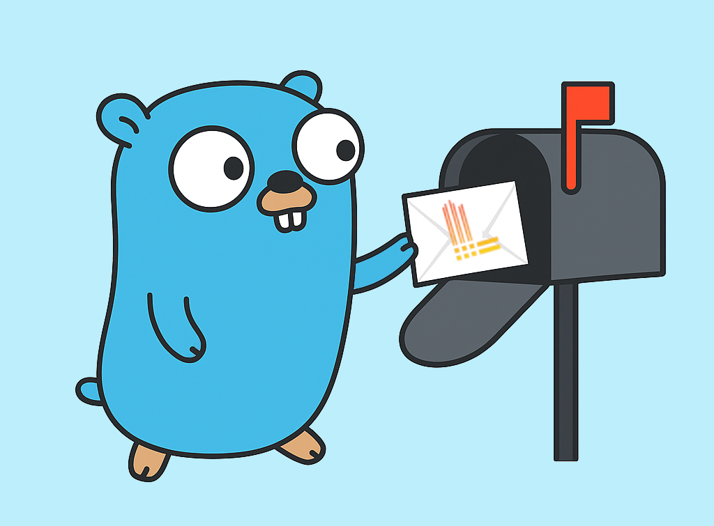

# logx — Extensible logger with file rotation and Loki support

[](https://go.dev/)
[](https://github.com/alex-cos/logx/actions/workflows/test.yml)
[](https://github.com/alex-cos/logx/actions/workflows/lint.yml)
[](LICENSE)
[](https://goreportcard.com/report/github.com/alex-cos/logx)



`logx` is a lightweight, extensible Go logging module that supports structured logging
to multiple destinations:

- local rotating files (`FileRotate`), and/or
- a **Grafana Loki** instance (`LokiClient`).

It's built for simplicity, safety, and performance — ideal for production systems.

---

## Installation

```bash
go get github.com/alex-cos/logx
```

---

## Features

- Multiple outputs — file, Loki, console, or custom writers
- Flexible configuration via functional options — log levels, JSON, UTC, caller, stack traces
- Buffered, non-blocking Loki client with automatic batching & retries
- Automatic file rotation using filerotate
- Thread-safe and efficient for concurrent applications
- Easily testable (implements io.Writer)

---

## Logger options

| Option              | Description                                  | Default |
| :------------------ | :------------------------------------------- | :------ |
| WithJSON()          | Output logs in JSON format                   | false   |
| WithUTC()           | Use UTC timestamps                           | false   |
| WithSource()        | Include source file:line (via slog.Source)   | false   |
| WithCaller()        | Include caller file:line (custom handler)    | false   |
| WithStack()         | Include stack trace on error level logs      | false   |
| WithBasePath(path)  | Base path to trim from caller file paths     | ""      |

---

## LokiClient options

| Option                          | Description                                  | Default            |
| :------------------------------ | :------------------------------------------- | :----------------- |
| WithLabels(map[string]string)   | Add static Loki labels (service, env, etc.)  | {}                 |
| WithBatchSize(int)              | Max number of entries before sending a batch | 100                |
| WithBufferSize(int)             | Size of the internal log buffer              | 1000               |
| WithPeriod(time.Duration)       | Interval between automatic batch flushes     | 15s                |
| WithWriteTimeout(time.Duration) | Timeout for writing to the buffer            | 100ms              |
| WithSendTimeout(time.Duration)  | Timeout for HTTP send operations             | 5s                 |
| WithHTTPClient(*http.Client)    | Custom HTTP client (TLS, proxy, auth, etc.)  | http.DefaultClient |
| WithHTTPS(bool)                 | Use HTTPS for Loki connection                | false              |
| WithBasicAuth(user, pass)       | HTTP Basic Authentication                    | ""                 |
| WithBearerToken(token)          | Bearer token authentication                  | ""                 |

---

## Quick Example

Write logs to a local rotating file

```go
package main

import (
  "io"
  "path/filepath"

  "github.com/alex-cos/logx"
)

func main() {
  logpath := filepath.Join("logs", "app")

  // Create a rotating file writer
  file, closeFile, err := logx.NewFileRotate(logpath, logx.WithUTC())
  if err != nil {
    panic(err)
  }
  defer closeFile()

  // Create the logger
  logger := logx.New(
    []io.Writer{file},
    "Info",
    logx.WithJSON(),
    logx.WithUTC(),
  ).With("service", "demo")

  logger.Info("Application started")
  logger.Warn("Disk almost full")
  logger.Error("Critical error", "code", 500)
}
```

---

## Send logs to Loki

```go
package main

import (
  "io"

  "github.com/alex-cos/logx"
)

func main() {
  // Create a Loki client
  loki, closeLoki := logx.NewLokiClient("localhost", 3100,
    logx.WithLabels(map[string]string{
      "service": "my_service",
      "env":     "dev",
    }),
  )
  defer closeLoki()

  // Combine file + Loki writers
  file, closeFile, err := logx.NewFileRotate("logs/app", logx.WithUTC())
  if err != nil {
    panic(err)
  }
  defer closeFile()

  logger := logx.New(
    []io.Writer{file, loki},
    "Debug",
    logx.WithJSON(),
    logx.WithUTC(),
  )

  logger.Info("Hello from logx!")
  logger.Error("Something went wrong", "code", 42)
}
```

---

## Caller and Stack traces

```go
logger := logx.New(
  []io.Writer{os.Stdout},
  "Debug",
  logx.WithJSON(),
  logx.WithCaller(),
  logx.WithStack(),
  logx.WithBasePath("/home/user/myproject/"),
)

logger.Error("something failed", logx.Error(err))
// Output includes caller: "myapp/main.go:42"
// and stack trace on error level
```

---

## Security & Production Notes

- Use a custom http.Client (`WithHTTPClient`) when sending logs to Grafana Cloud or TLS endpoints.
- Set realistic timeouts for slow networks or proxies.
- The Loki client is non-blocking — logs may be dropped if the buffer is full.
- Errors and retries are reported to stderr.
- Consider exposing Prometheus metrics (sent, dropped, failed) for monitoring.
